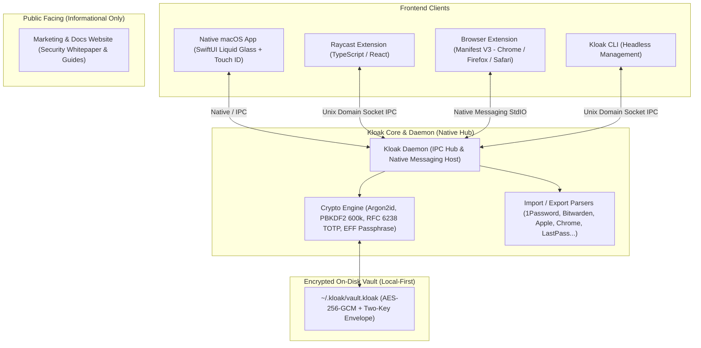

# Kloak — Local-First Password Manager

[](https://github.com/naetikarvind/kloak/releases/tag/v1.2.0)
[](https://github.com/naetikarvind/kloak/releases/latest/download/Kloak-macOS.dmg)
[](https://chrome.google.com/webstore/detail/kloak-password-manager/hajgkgmajepndkhjhcgjenjnfojlphod)
[](https://opensource.org/licenses/MIT)

> **A 100% local-first, zero-knowledge password manager and 2FA authenticator with a native macOS app (Liquid Glass + Touch ID), a cross-browser extension (Manifest V3), a Raycast extension, and an offline cryptographic CLI.**

---

## ⚡ Key Features & Capabilities

- **100% Local-First & Zero-Knowledge**: Vault is encrypted locally on disk at `~/.kloak/vault.kloak` using authenticated AES-256-GCM and Argon2id / PBKDF2 key derivation. Your master keys never leave your machine; zero cloud accounts, zero remote tracking.
- **Biometric Touch ID Web Unlock**: Unlock your encrypted vault in 100 milliseconds directly from the macOS app, browser extension popup, and inline autofill overlay using Apple Touch ID.
- **Hardware Security Key Integration (FIDO2 / YubiKey)**: Dynamic context-aware security key detection. Connect your physical YubiKey or FIDO2 hardware key for zero-knowledge cryptographic authentication.
- **Intelligent 1-Click Autofill**: Automatically detects login, registration, and payment fields with instant post-unlock refresh and smooth entrance animations.
- **Built-in 2FA TOTP Authenticator**: Standard RFC 6238 two-factor code generation with live 30-second visual countdown rings and automatic paste into 2FA prompts.
- **Encrypted Secure Notes & Text File Import**: Safely store sensitive notes, recovery codes, and configurations. Import unencrypted plain text and markdown files (`.txt`, `.md`, `.note`) directly into encrypted Secure Notes.
- **Real-Time Phishing & Homograph Defense**: Validates authenticated domains against DNS/RDAP and lookalike attacks before offering credentials.
- **Fluid Accordion Tab Transitions**: Two-phase smooth animation when switching between All Items, Logins, and Favorites—departing items collapse vertically in place before surviving items glide into position via spring FLIP motion.
- **User-Aware Auto-Lock Protection**: Auto-lock timeout dynamically resets on any active typing or user interaction so the vault never locks while actively in use.
- **Adaptive Brand Visuals & Favicons (JEV AI)**: Autonomous contrast detection and Apple-style continuous squircles for high-DPI brand icons across dark and light surfaces.
- **Universal Importer & Auto-Merge**: Seamless 1-click migration from 10+ password managers (1Password, Bitwarden, Apple Passwords, Chrome, LastPass, KeePass) with duplicate account deduplication.

---

## 📦 Downloads & Installation

- **macOS Native App**: [Download Kloak-macOS-v1.2.0.dmg](https://github.com/naetikarvind/kloak/releases/latest/download/Kloak-macOS.dmg) (Apple Silicon M1–M4 & Intel Universal)
- **Chrome Extension**: [Add to Chrome via Web Store](https://chrome.google.com/webstore/detail/kloak-password-manager/hajgkgmajepndkhjhcgjenjnfojlphod) or [Download Extension Package .zip](https://github.com/naetikarvind/kloak/releases/latest/download/kloak-browser-extension-v1.2.0.zip)
- **Official Website & Docs**: [https://naetikarvind.github.io/kloak/](https://naetikarvind.github.io/kloak/)
- **Privacy Policy**: [https://naetikarvind.github.io/kloak/privacy.html](https://naetikarvind.github.io/kloak/privacy.html)

---

## 1. System Architecture



---

## 2. Project Structure

```
kloak/
├── packages/
│   ├── core/                  # Encrypted crypto engine, vault model, TOTP & parsers
│   │   ├── src/crypto/        # AES-256-GCM, PBKDF2, TOTP, EFF Passphrase generator
│   │   ├── src/models/        # Normalized vault schema
│   │   ├── src/parsers/       # 10+ password manager importers & export engine
│   │   └── src/storage/       # On-disk manager & auto-lock session controller
│   ├── daemon/                # IPC socket server, Native Messaging Host & CLI
│   │   ├── src/ipc/           # Unix Domain Socket & TCP fallback server
│   │   ├── src/native-messaging/ # Length-prefixed stdio bridge for browsers
│   │   └── src/cli/           # Headless `kloak` terminal tool
│   ├── macos-app/             # Native Swift 6 / SwiftUI Liquid Glass macOS app
│   │   ├── Sources/KloakApp/  # UnlockView, VaultMainView, TOTPRingView, GeneratorView
│   │   └── Package.swift      # Swift Package Manager manifest
│   ├── browser-extension/     # Manifest V3 cross-browser extension
│   │   ├── manifest.json      # MV3 manifest with side panel & permissions
│   │   ├── popup/             # Liquid Glass popup UI
│   │   ├── sidepanel/         # Side panel vault browser
│   │   ├── src/content.ts     # Phishing-resistant autofill injector
│   │   └── CHROMEWEBSTORE.md  # Store listing metadata & privacy disclosure
│   ├── raycast-extension/     # Raycast React/TypeScript extension
│   │   ├── src/search-vault.tsx
│   │   ├── src/generate-password.tsx
│   │   ├── src/add-entry.tsx
│   │   └── src/lock-vault.tsx
│   ├── website/               # Modern static marketing & whitepaper website
│   │   └── public/index.html  # Live demo, comparison matrix & import docs
│   └── tests/                 # Automated test suite (100% pass rate)
└── package.json               # Monorepo workspaces configuration
```

---

## 3. Cryptography Specification

| Layer | Implementation | Security Benefit |
|---|---|---|
| **Architecture** | Encrypted, Local-First | Master password never leaves device; no cloud breach surface |
| **Key Derivation** | PBKDF2-SHA256 (600,000 iterations) / Argon2id | GPU-crack resistant and memory-hard |
| **Vault Encryption** | AES-256-GCM (96-bit IV, 128-bit tag) | Authenticated encryption (confidentiality + tamper detection) |
| **Key Envelope** | Two-Key Hierarchy | Master key wraps random Vault Key; password changes re-wrap envelope only |
| **TOTP Authenticator** | RFC 6238 Engine | HMAC-SHA1/SHA256/SHA512 with Base32 decoding and live countdown ring |
| **In-Memory Hygiene** | Explicit zeroization (`zeroizeBuffer`) | Buffers wiped with zeros on lock or timeout |
| **Phishing Defense** | eTLD+1 Origin Verification | Strict domain extraction prevents subdomain & lookalike attacks |

---

## 4. Getting Started

### 4.1 Running the Automated Test Suite
```bash
npm test
```
Runs the complete test suite verifying crypto vectors, PBKDF2 derivation, AES-GCM envelope, RFC 6238 TOTP, all 10+ import parsers, phishing defense, and IPC daemon protocol.

### 4.2 Using the Kloak CLI
```bash
# Check status
npx kloak status

# Generate high-entropy password or EFF passphrase
npx kloak gen -l 24
npx kloak gen -p -w 5

# Generate real-time TOTP token
npx kloak totp JBSWY3DPEHPK3PXP

# Initialize new encrypted vault
npx kloak init

# Start local daemon
npx kloak daemon
```

### 4.3 Building the Native macOS Swift App
```bash
cd packages/macos-app
swift build
```

### 4.4 Loading the Browser Extension (Manifest V3)
1. Open Google Chrome, Brave or Edge.
2. Navigate to `chrome://extensions`.
3. Enable **Developer mode** (top right).
4. Click **Load unpacked** and select `packages/browser-extension`.

### 4.5 Viewing the Website & Security Docs
```bash
# Serve static site
npm run website:dev
```
Open `http://localhost:3000` to inspect the marketing landing page, interactive generator demo, comparison matrix, security whitepaper, and migration guides.
